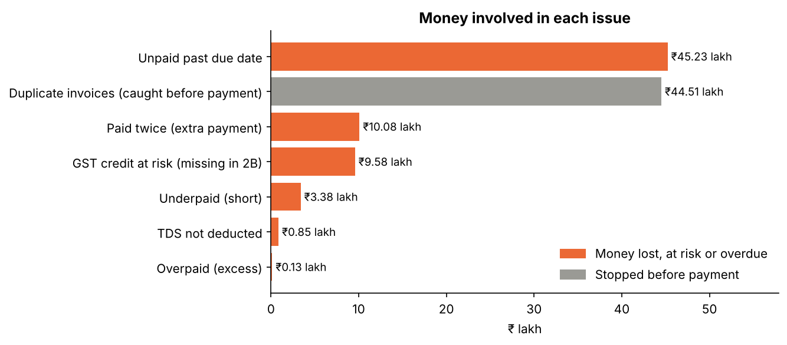
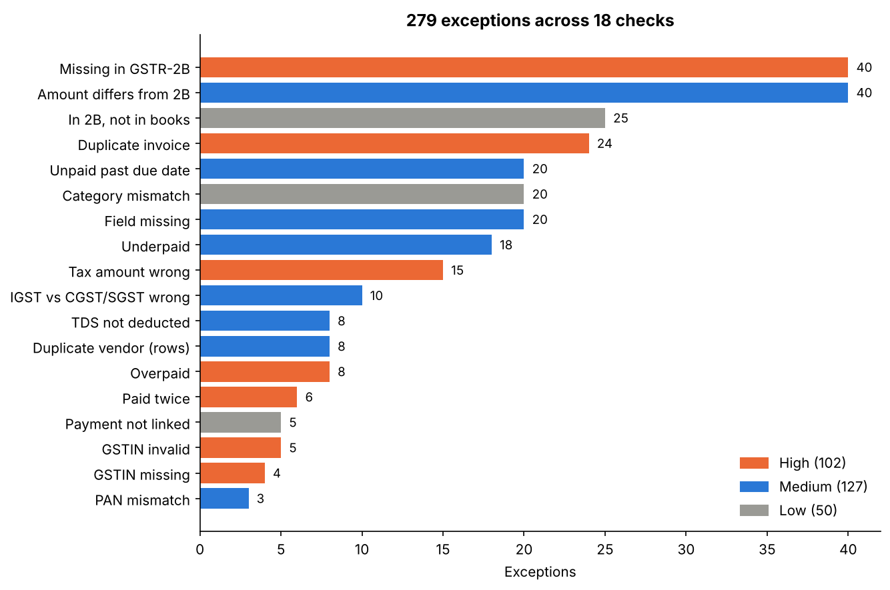
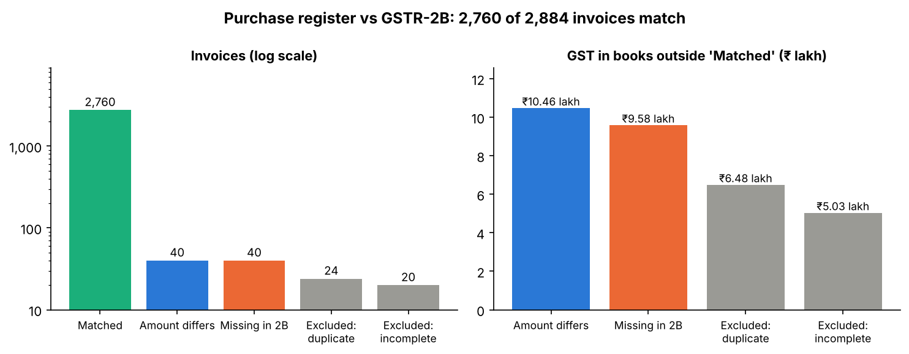
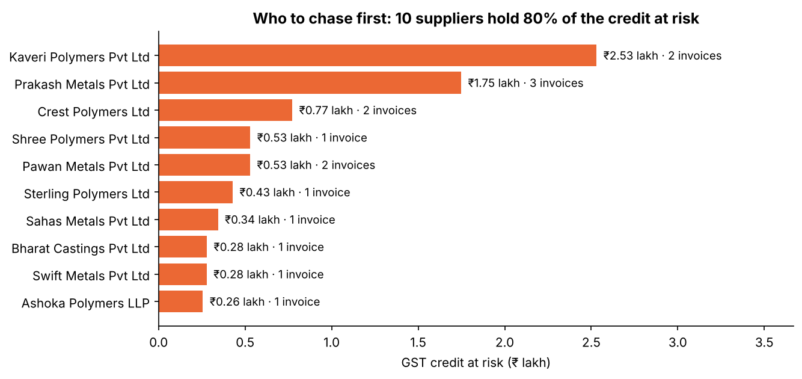
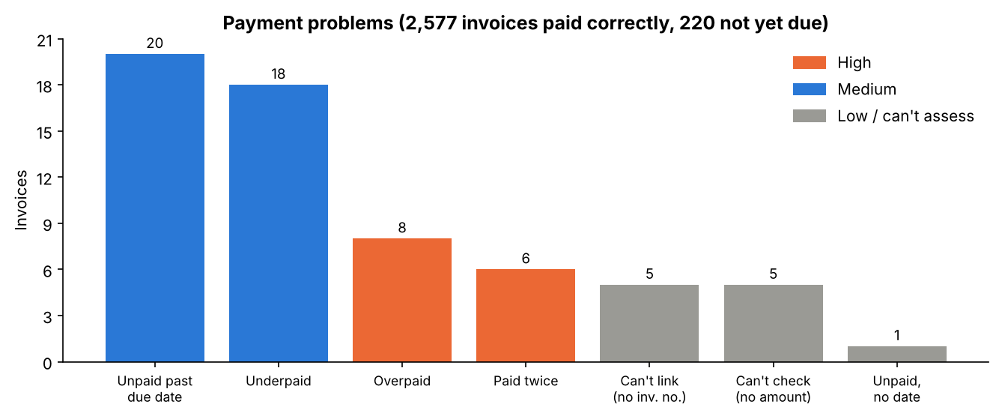

# InvoiceDesk: AP Invoice QA & GST Input Credit Reconciliation

**Are the supplier invoices clean, can the GST credit be claimed, and was every invoice paid correctly?**

An accounts payable quality review for a fictional Indian manufacturer: 18 checks across the vendor master, purchase register, GSTR-2B and payments, built in **Excel** and **PostgreSQL**, ending in one exception report with severity, likely cause and next action.

> All data is synthetic. Every company, PAN and GSTIN is made up. Errors were planted on purpose, and an independent answer key proves the checks find all of them.

## Results

| | |
|---|---|
| Invoices reviewed | 2,884 (₹63.0 crore), 99 vendor records, Apr–Sep 2026 |
| Clean invoices | 2,680 (93%) |
| Exceptions | 279 (102 High, 127 Medium, 50 Low) |
| GST input credit at risk | **₹9.58 lakh** on 40 invoices missing from GSTR-2B |
| Duplicate invoices | 24 (₹44.5 lakh), 6 booked under duplicate vendor records; none was paid |
| Paid twice | 6 invoices, ₹10.1 lakh paid extra |
| Overdue and unpaid | 20 invoices, ₹45.2 lakh, up to 166 days late |
| TDS not deducted | 8 professional-fee and rent payments (about ₹84,737) |



**Root cause found:** 4 suppliers exist twice in the vendor master under name variants ("Swift Metals Pvt Ltd" / "Swift Metals Private Limited"). That is how the cross-vendor duplicate invoices got in.

## The checks

| Area | Check | Count |
|---|---|---|
| Vendor master | GSTIN missing / invalid format / PAN mismatch / duplicate vendor (rows) | 4 / 5 / 3 / 8 |
| Invoices | Duplicate (same GSTIN + invoice number + total) | 24 |
| Invoices | Missing field / tax amount wrong / tax type wrong (IGST vs CGST+SGST) / category mismatch | 20 / 15 / 10 / 20 |
| GSTR-2B | Missing in 2B / amount mismatch / in 2B but not in books | 40 / 40 / 25 |
| Payments | Paid twice / overpaid / underpaid / unpaid and overdue | 6 / 8 / 18 / 20 |
| Payments | Payment not linked / TDS not deducted | 5 / 8 |



40 amount mismatches = 25 where the supplier reported a different amount + 15 where the books have the wrong tax (the supplier reported the correct tax), so two checks confirm the same error.

## GSTR-2B reconciliation



The credit at risk is concentrated: 10 suppliers hold 80% of it, so AP knows who to chase first.



## Payments



## Method

- **Data:** `generate_data.py` creates the vendor master, purchase register, GSTR-2B and payments, and plants errors (`answer_key/planted_errors.csv`).
- **Answer key:** `rules.py` applies the rules independently and writes `answer_key/expected_results.csv`. Every planted error is found.
- **SQL:** `sql/01`–`06` run the same rules in PostgreSQL and produce `outputs/exception_report.csv`, identical to the answer key record by record.
- **Excel:** `excel/InvoiceDesk_Solved.xlsx` has every check as a formula column (COUNTIFS, XLOOKUP, a GSTIN format rule) and a summary sheet. An INDEX/MATCH copy was recalculated and matches the answer key on every count and every invoice status.

Rules: ₹1 tolerance for rounding; Maharashtra (27) suppliers charge CGST + SGST, others IGST; payment due = invoice date + vendor terms; review date 31 Oct 2026; TDS of 10% on professional fees and rent.

## How to run

```bash
python generate_data.py && python rules.py          # data + answer key (optional: files are included)
createdb invoicedesk
psql -d invoicedesk -f sql/01_load.sql               # run 01 to 06 in order from this folder
psql -d invoicedesk -f sql/07_report_tables.sql      # summary tables for the charts
python charts.py                                      # draws images/*.png, checked against the answer key
python build_excel.py --verify                        # rebuild the Excel files and check them (needs LibreOffice)
```

## Limitations

- Synthetic data; the planted error rates are not real-world rates.
- The GSTIN check covers format (length, state code, the "Z") but not the final check character.
- TDS is simplified to one 10% rule for professional fees and rent.
- Matching needs an exact GSTIN and invoice number; real reconciliations also handle formatting differences in invoice numbers.

## Structure

```
data/          vendor_master, purchase_register, gstr_2b, payments, category_rates (CSV)
excel/         InvoiceDesk_Data.xlsx (raw) and InvoiceDesk_Solved.xlsx (all checks)
sql/           01_load … 06_exception_report, 07_report_tables (PostgreSQL)
outputs/       exception_report.csv and the summary tables behind the charts
images/        README charts (charts.py)
answer_key/    planted errors, expected results and counts
```

*Salil Gokhale · [LinkedIn](https://www.linkedin.com/in/salil-gokhale-analytics) · [GitHub](https://github.com/Salil360-cyber)*
